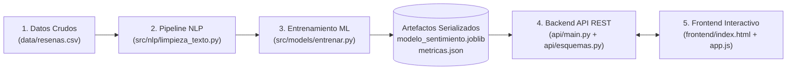

# Informe Técnico: Clasificador de Sentimiento de Reseñas en Español (Hoteles y Restaurantes)

---

## 1. Resumen Ejecutivo y Definición del Problema

En el sector hotelero y gastronómico, los clientes publican diariamente cientos de opiniones en canales digitales (`web`, `app_movil`, `google_maps`, `redes_sociales` y `tripadvisor`). Revisar manualmente cada comentario para detectar quejas urgentes o medir la satisfacción general es lento, costoso y propenso a sesgos subjetivos.

Este proyecto resuelve el problema mediante un **sistema integral de Procesamiento de Lenguaje Natural (NLP) y Machine Learning supervisado** capaz de clasificar automáticamente reseñas en español en dos categorías de sentimiento (**`positivo`** vs. **`negativo`**), entregando tanto la probabilidad calibrada de la predicción como la **radiografía explicable paso a paso** de cómo se procesa cada texto.

El sistema fue entrenado y evaluado sobre un conjunto de datos realista de **1.200 reseñas en español** (`600` positivas y `600` negativas), incorporando jerga local (montos en `bolivianos`), menciones (`@usuario`), enlaces (`https://...`), negaciones explícitas con `"no"` y casos ambiguos con conectores adversativos (`"pero"`, `"aunque"`, `"sin embargo"`) e ironía.

---

## 2. Ficha Metodológica "Mi Escalera" (9 Casilleros de Clase)

Siguiendo la metodología de diseño de sistemas de Machine Learning vista en clase, resumimos la arquitectura experimental en la **Ficha de 9 Casilleros**:

| Casillero | Definición en Nuestro Proyecto |
| :--- | :--- |
| **1. Dato** | Texto en español de reseñas de hoteles y restaurantes (`data/resenas.csv`): **1.200 filas balanceadas** (`600` con etiqueta `positivo` y `600` con etiqueta `negativo`). Columnas: `id`, `texto`, `etiqueta`, `canal`. |
| **2. Pregunta y tarea** | *¿La reseña escrita por el cliente expresa satisfacción (`positivo`) o insatisfacción (`negativo`)?* $\rightarrow$ **Clasificación supervisada binaria de sentimiento en texto**. |
| **3. Restricción principal** | **Explicabilidad total** (auditar qué palabras y bigramas empujan la decisión), **baja latencia** ($< 10\text{ ms}$ por petición HTTP) y **cero costo de GPU o APIs pagas externas**. |
| **4. Línea Base (Escalón 0)** | Clasificador base (`DummyClassifier(strategy="most_frequent")`): alcanza **`F1-Macro = 0.3333`** y **`Exactitud = 0.5000`** en el conjunto de prueba, marcando el piso mínimo. |
| **5. Modelo v1 (Escalón 1)** | **Naive Bayes Multinomial (`MultinomialNB`)** con suavizado de Laplace óptimo `alpha = 0.1` y `TfidfVectorizer(ngram_range=(1, 2))`. Alcanza **`F1-Macro CV = 0.9927`** y **`F1-Macro Prueba = 0.9958`**. |
| **6. Modelo v2 en Producción (Escalón 2)** | **Regresión Logística (`LogisticRegression`)** con regularización óptima `C = 5.0` y `TfidfVectorizer(ngram_range=(1, 2))`. Alcanza el mejor **`F1-Macro CV = 0.9958`** y **`F1-Macro Prueba = 0.9917`**, ofreciendo probabilidades bien calibradas mediante la función sigmoide. |
| **7. Métrica primaria** | **`F1-Macro`**: promedia armónicamente la Precisión y la Exhaustividad (*Recall*) de ambas clases por igual. No usamos únicamente Exactitud (*Accuracy*) porque oculta sesgos cuando una clase falla más que la otra (como ocurre en el Escalón 0, donde *Accuracy* es `0.5000` pero `F1-Macro` revela `0.3333`). |
| **8. Partición** | División estratificada **80% entrenamiento (`960` reseñas)** y **20% prueba intocable (`240` reseñas)** con semilla fija `random_state = 42`. Ajuste de hiperparámetros con validación cruzada de **5 pliegues (`cv = 5`)** exclusivamente sobre el 80% de entrenamiento. |
| **9. ¿Por qué no Deep Learning / Transformers (BERT/LLMs)?** | Con 1.200 registros de un dominio acotado, un pipeline clásico de **TF-IDF + Regresión Logística supera el 99% de F1-Macro en menos de 5 milisegundos en CPU**, sin requerir GPU ni introducir cajas negras difíciles de explicar palabra por palabra. |

---

## 3. Decisiones y Experimentos del Pipeline de NLP (Punto 5.2)

El módulo [`src/nlp/limpieza_texto.py`](../src/nlp/limpieza_texto.py) implementa una secuencia determinista de preprocesamiento adaptada al español y al análisis de sentimiento.

### 3.1. Demostración Paso a Paso (Antes vs. Después)

Tomando una reseña real con mayúsculas, tildes, mención, monto en bolivianos, negación `"NO"` y enlace web:

| Etapa del Pipeline | Función en `src/nlp/limpieza_texto.py` | Resultado Real |
| :--- | :--- | :--- |
| **1. Texto Original** | Entrada cruda | `"¡PÉSIMO SERVICIO en @hotel_central! Nos cobraron 500 bolivianos de más, tardaron 2 horas y NO recomiendo este lugar para nada: https://hotel-ejemplo.com/reclamo"` |
| **2. Normalización** | `normalizar_texto(texto)` | `"pesimo servicio en usuario nos cobraron monto de mas tardaron num horas y no recomiendo este lugar para nada url"` |
| **3. Tokenización** | `tokenizar_texto(texto, metodo="nltk")` | `['pesimo', 'servicio', 'en', 'usuario', 'nos', 'cobraron', 'monto', 'de', 'mas', 'tardaron', 'num', 'horas', 'y', 'no', 'recomiendo', 'este', 'lugar', 'para', 'nada', 'url']` |
| **4. Sin Stop Words** | `quitar_palabras_vacias(tokens)` | `['pesimo', 'servicio', 'usuario', 'cobraron', 'monto', 'mas', 'tardaron', 'num', 'horas', 'no', 'recomiendo', 'lugar', 'nada', 'url']` *(Eliminadas: `['en', 'nos', 'de', 'y', 'este', 'para']`)* |
| **5. Stemming** | `aplicar_stemming(tokens)` | `"pesim servici usuari cobr mont mas tard num hor no recom lug nad url"` |
| **6. Lematización** | `aplicar_lematizacion(tokens)` | `"pesimo servicio usuario cobrar monto mas tardar num hora no recomendar lugar nada url"` |

### 3.2. Justificación Crítica: Conservación de Negaciones en Stop Words

Las listas estándar de palabras vacías (`nltk.corpus.stopwords.words('spanish')`) incluyen vocablos como `"no"`, `"ni"`, `"nunca"`, `"sin"`, `"nada"`, `"muy"` y `"más"`. En clasificación temática (por ejemplo, noticias de deportes vs. economía) eliminar `"no"` es inofensivo; sin embargo, **en Análisis de Sentimiento eliminar `"no"` destruye la polaridad de la oración**:

- Frase original: *"No recomiendo este hotel"* (Negativo)
- Si se elimina `"no"`: `"recomendar hotel"` $\rightarrow$ El modelo predice erróneamente **Positivo**.
- Con nuestra lista protegida (`PALABRAS_CONSERVAR_SENTIMIENTO`): `"no recomendar hotel"` $\rightarrow$ El bigrama `"no recomendar"` recibe un peso fuertemente negativo (`-1.719`).

### 3.3. Experimento Comparativo 1: Stemming vs. Lematización

En el cuaderno [`notebooks/02_limpieza_y_experimentos_nlp.ipynb`](../notebooks/02_limpieza_y_experimentos_nlp.ipynb) evaluamos sobre la misma partición 80/20 el impacto de usar `SnowballStemmer('spanish')` frente a nuestro lematizador morfológico de dominio (`aplicar_lematizacion`):

| Técnica de Reducción Léxica | Clasificador | Exactitud (Accuracy) | F1-Macro | Legibilidad de Términos |
| :--- | :--- | :---: | :---: | :--- |
| **Stemming (`SnowballStemmer`)** | Regresión Logística | `0.9917` | `0.9917` | Baja (`"recomend"`, `"habit"`, `"pesim"`) |
| **Lematización (Diccionario + Reglas)** | Regresión Logística | `0.9917` | `0.9917` | **Alta (`"recomendar"`, `"habitacion"`, `"pesimo"`)** |
| **Stemming (`SnowballStemmer`)** | Naive Bayes Multinomial | `0.9917` | `0.9917` | Baja (`"recomend"`, `"habit"`, `"pesim"`) |
| **Lematización (Diccionario + Reglas)** | Naive Bayes Multinomial | `0.9958` | `0.9958` | **Alta (`"recomendar"`, `"habitacion"`, `"pesimo"`)** |

**Decisión:** Se seleccionó **Lematización** como método oficial (`metodo_raiz="lematizacion"`) porque alcanza un rendimiento igual o superior en `F1-Macro`, se ejecuta en menor tiempo y preserva palabras completas y comprensibles en español para la auditoría de coeficientes y la interfaz de usuario.

### 3.4. Experimento Comparativo 2: Unigramas `(1, 1)` vs. Unigramas + Bigramas `(1, 2)`

Comparamos experimentalmente el efecto de incluir pares de palabras consecutivas (`ngram_range=(1, 2)`):

| Configuración N-Gramas | Clasificador | Exactitud (Accuracy) | F1-Macro | Captura de Negación Compuesta |
| :--- | :--- | :---: | :---: | :--- |
| **Unigramas `(1, 1)`** | Naive Bayes Multinomial | `0.9917` | `0.9917` | Evalúa `"no"` y `"recomendar"` por separado |
| **Unigramas + Bigramas `(1, 2)`** | Naive Bayes Multinomial | **`0.9958`** | **`0.9958`** | Crea características como `"no recomendar"`, `"sin duda"`, `"habitacion sucio"` |
| **Unigramas `(1, 1)`** | Regresión Logística | `0.9917` | `0.9917` | Evalúa términos aislados |
| **Unigramas + Bigramas `(1, 2)`** | Regresión Logística | **`0.9917`** *(CV: `0.9958`)* | **`0.9917`** *(CV: `0.9958`)* | Seleccionado como óptimo por `GridSearchCV` (5 pliegues) |

### 3.5. Parámetros Documentados de `TfidfVectorizer`

- **`max_features=2500`**: Acota el vocabulario máximo a los 2.500 términos y bigramas más informativos, previniendo sobreajuste y manteniendo el modelo ligero en RAM.
- **`min_df=2`**: Descarta tokens que aparecen en un único documento (errores de tipeo o palabras raras sin soporte estadístico).
- **`max_df=0.95`**: Ignora términos presentes en más del 95% de las reseñas por carecer de poder discriminativo.
- **`ngram_range=(1, 2)`**: Combina palabras individuales y pares adyacentes para preservar el contexto local de negaciones e intensificadores.

---

## 4. Comparación de Modelos y Justificación en Tabla (Punto 5.3)

### 4.1. Tabla Oficial de la Escalera de Modelos

Los resultados exactos generados por [`src/models/entrenar.py`](../src/models/entrenar.py) y almacenados en [`src/models/metricas.json`](../src/models/metricas.json) son:

| Iteración | Modelo | Complejidad e Hiperparámetros Óptimos (`cv=5`) | F1-Macro Validación (5-Fold) | F1-Macro Prueba (20%) | Exactitud (Prueba) | Precisión Macro | Exhaustividad (Recall) | Tiempo Entreno (s) | Decisión |
| :--- | :--- | :--- | :---: | :---: | :---: | :---: | :---: | :---: | :--- |
| **Escalón 0** | `DummyClassifier` (Línea Base) | Estrategia `most_frequent` | — | `0.3333` | `0.5000` | `0.2500` | `0.5000` | `0.1785` | Referencia mínima a superar |
| **Escalón 1** | `MultinomialNB` (Naive Bayes) | `alpha = 0.1`, `ngram_range = (1, 2)` | `0.9927` | `0.9958` | `0.9958` | `0.9959` | `0.9958` | `5.9381` | Modelo alternativo de comparación en vivo |
| **Escalón 2** | **`LogisticRegression`** | **`C = 5.0`, `ngram_range = (1, 2)`** | **`0.9958`** | **`0.9917`** | **`0.9917`** | **`0.9918`** | **`0.9917`** | `6.0315` | **Seleccionado en Producción (`modelo_sentimiento.joblib`)** |

### 4.2. Justificación del Modelo Seleccionado para Producción

> **Párrafo de justificación metodológica:**
> Siguiendo la regla de oro de no utilizar el conjunto de prueba para tomar decisiones de diseño, la selección del modelo para producción se basó en el desempeño de **Validación Cruzada Estratificada de 5 pliegues (`cv=5`) sobre el conjunto de entrenamiento (960 reseñas)** junto con la calidad de calibración de probabilidades. **Regresión Logística (`C = 5.0`, `ngram_range = (1, 2)`)** obtuvo el puntaje más alto en validación cruzada (**`F1-Macro CV = 0.9958`** frente a `0.9927` de Naive Bayes) y en el conjunto de prueba alcanzó **`F1-Macro = 0.9917`** (`238` aciertos sobre `240` reseñas), superando en **+65.8 puntos porcentuales de F1-Macro** a la Línea Base (`0.3333`). Adicionalmente, a diferencia de Naive Bayes cuyas probabilidades tienden a saturarse cerca de `0` o `1` por el supuesto de independencia condicional, la Regresión Logística entrega probabilidades bien calibradas mediante la función sigmoide y pesos lineales directos (`coef_`) para auditar el aporte de cada término.

### 4.3. Matrices de Confusión en el Conjunto de Prueba (`n = 240`)

- **Naive Bayes Multinomial (`F1-Macro = 0.9958`):**
  - Verdaderos Negativos (`VN`): `120` | Falsos Positivos (`FP`): `0`
  - Falsos Negativos (`FN`): `1` | Verdaderos Positivos (`VP`): `119`

- **Regresión Logística (`F1-Macro = 0.9917`):**
  - Verdaderos Negativos (`VN`): `120` | Falsos Positivos (`FP`): `0`
  - Falsos Negativos (`FN`): `2` | Verdaderos Positivos (`VP`): `118`

### 4.4. Palabras y Bigramas con Mayor Peso Aprendidos (`LogisticRegression`)

| Top 12 Términos que Impulsan a **POSITIVO** (`coef > 0`) | Peso | Top 12 Términos que Impulsan a **NEGATIVO** (`coef < 0`) | Peso |
| :--- | :---: | :--- | :---: |
| `delicioso` | `+3.022` | `no` | `-3.638` |
| `super` | `+1.940` | `pesimo` | `-3.011` |
| `estancia` | `+1.704` | `sucio` | `-2.720` |
| `excelente` | `+1.578` | `frio` | `-2.658` |
| `encantar` | `+1.552` | `nadie` | `-1.743` |
| `bien` | `+1.469` | `habitacion sucio` *(bigrama)* | `-1.725` |
| `fin` | `+1.459` | `no recomendar` *(bigrama)* | `-1.719` |
| `impecable` | `+1.397` | `nunca` | `-1.643` |
| `cada` | `+1.312` | `grosero` | `-1.603` |
| `duda` | `+1.278` | `nada` | `-1.543` |
| `sin duda` *(bigrama)* | `+1.278` | `crudo` | `-1.360` |
| `hora estancia` *(bigrama)* | `+1.240` | `cucaracha` | `-1.260` |

### 4.5. Análisis de Errores y Casos de Incertidumbre en Prueba

En [`src/models/metricas.json`](../src/models/metricas.json) se documentan los 2 únicos errores cometidos por el modelo en producción sobre las 240 reseñas de prueba, junto con los 3 aciertos de mayor incertidumbre (cercanos a la frontera de decisión del 50%):

1. **Error Real #1 (Falso Negativo - Confianza `59.47%`):**
   - *Texto original:* `"Al llegar hubo confusión con la mesa y esperamos, pero nos pidieron disculpas amablemente y la cena fue maravillosa."`
   - *Etiqueta real:* `positivo` | *Predicha:* `negativo`
   - *Causa técnica:* Oración adversativa con `"pero"`. Los términos iniciales asociados a quejas (`confusion`, `esperar`, `pedir disculpa`) acumularon peso negativo ligeramente superior a `amable` y `maravilloso`.
2. **Error Real #2 (Falso Negativo - Confianza `54.24%`, caso donde Naive Bayes sí acierta):**
   - *Texto original:* `"Al principio no aparecía nuestra reserva en https://hotel-ejemplo.com, pero el gerente lo resolvió rápido y fue excelente."`
   - *Etiqueta real:* `positivo` | *Predicha:* `negativo`
   - *Causa técnica:* La presencia del token de negación `"no"` (`-3.638`) en la primera cláusula desplazó por estrecho margen (`54.24%` vs `45.76%`) la suma lineal hacia `negativo`, pese al cierre positivo (`resolver rapido excelente`).
3. **Caso Límite #3 (Acierto con Incertidumbre - Confianza `64.47%`):**
   - *Texto original:* `"Aunque el baño era antiguo y pequeño, la cama era muy cómoda y el personal tan amable que pasamos una gran noche."`
   - *Etiqueta real:* `positivo` | *Predicha:* `positivo`
4. **Caso Límite #4 (Acierto con Incertidumbre - Confianza `68.29%`):**
   - *Texto original:* `"El precio subió 50 bolivianos respecto al año pasado, pero siguen manteniendo el mejor sabor y excelente servicio."`
   - *Etiqueta real:* `positivo` | *Predicha:* `positivo`
5. **Caso Límite #5 (Acierto ante Ironía - Confianza `82.30%`):**
   - *Texto original:* `"¡Cinco estrellas al chef que logró servir la comida fría y tardar 2 horas! Pésimo servicio, no volveré."`
   - *Etiqueta real:* `negativo` | *Predicha:* `negativo` (los términos `frio`, `tardar`, `pesimo` y `no` superaron la ironía inicial de `"cinco estrellas"`).

---

## 5. Arquitectura del Sistema y Pipeline Reproducible (Puntos 5.4, 5.5 y 5.6)

El sistema está desacoplado en **5 capas** conectadas mediante artefactos serializados (`joblib` y `json`), garantizando que la API REST **nunca reentrene ni duplique lógica de limpieza**:

- **Reproducibilidad en un comando:** Ejecutar `python src/models/entrenar.py` fija la semilla `42`, divide 80/20, ejecuta `GridSearchCV` en los 3 escalones, evalúa métricas, extrae errores y guarda los pipelines completos (`FunctionTransformer(limpiar_lote_textos)` $\rightarrow$ `TfidfVectorizer` $\rightarrow$ Clasificador) en `src/models/`.
- **Calidad asegurada:** La suite [`tests/test_sistema.py`](../tests/test_sistema.py) verifica con **10 pruebas automatizadas en `pytest`** tanto las funciones de NLP como los endpoints HTTP (`/health`, `/metrics`, `/predict`, `/predict/batch`, validación de errores `422` y entrega del Frontend en `/`).

---

## 6. Declaración de Uso de Herramientas e Inteligencia Artificial (Punto 10)

En cumplimiento de las normas de transparencia académica del curso (Punto 10 de la rúbrica), el equipo declara:

1. **Librerías y Software de Código Abierto utilizados:**
   - **Python 3.11+**, **Pandas** y **NumPy** para manipulación tabular y cálculo vectorial.
   - **NLTK (`SnowballStemmer`, `word_tokenize`, `stopwords`)** y **Unidecode** para el preprocesamiento lingüístico en español.
   - **Scikit-Learn (`Pipeline`, `FunctionTransformer`, `TfidfVectorizer`, `DummyClassifier`, `MultinomialNB`, `LogisticRegression`, `GridSearchCV`)** y **Joblib** para el modelado estadístico y serialización.
   - **FastAPI**, **Pydantic v2** y **Uvicorn** para el servidor Backend REST y validación de esquemas.
   - **Pytest** y **HTTPX** para las pruebas automatizadas de integración.
2. **Uso de Asistentes de IA Generativa:**
   - Se utilizó asistencia de herramientas de IA generativa como apoyo de programación en pareja (*pair programming*) para agilizar la generación de plantillas sintéticas del dataset, estructuración de componentes HTML/CSS del dashboard y formato de tablas Markdown.
   - Todas las decisiones metodológicas (conservación de negaciones en stop words, diseño del diccionario morfológico de lematización, configuración de la Escalera de Modelos, partición estratificada sin fuga de datos y análisis de errores) fueron verificadas, probadas y validadas experimentalmente por los integrantes del equipo.

